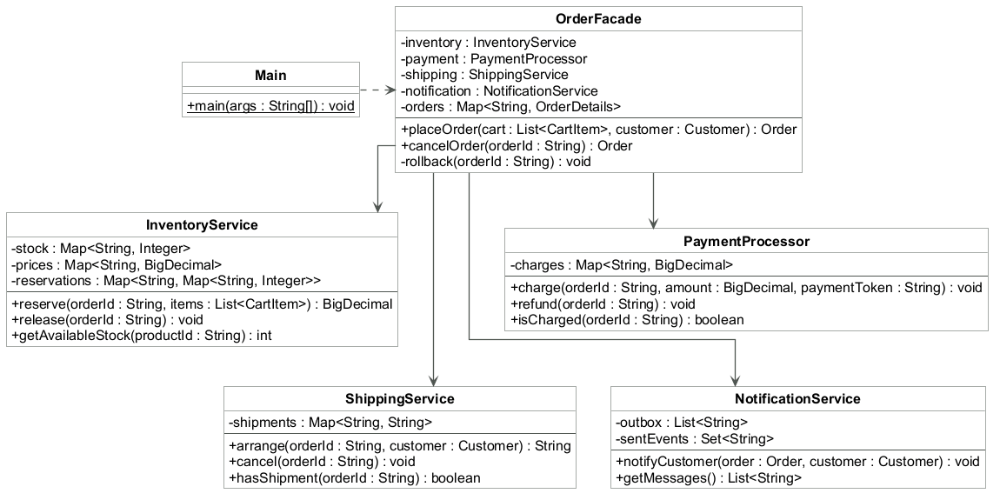

# Assignment 4 — Facade Pattern

**Course:** ShP-2216 — Software Design Patterns  
**Student:** Anuar Maksut  
**Group:** SE-2537  
**Option:** B — Online Order Processing  
**Language:** Java 17

## 1. Introduction

An online shop must reserve products, take payment, arrange shipping, and prepare a notification. These steps must occur in the correct order. A failure can require earlier steps to be reversed.

This project uses `OrderFacade` to coordinate four services. The client calls `placeOrder(cart, customer)` or `cancelOrder(orderId)`. It does not need to manage the service sequence or failure recovery.

All Java classes are in the src folder. The project has no package declarations. Tests are in a separate tests folder.

The project uses in-memory data to keep the pattern easy to follow. It has no external payment, shipping, or email connection. Product prices use `BigDecimal` to avoid binary floating-point errors.

### Terms

| Term | Meaning in this project |
| --- | --- |
| Facade | A class that gives a simple interface to a group of services. |
| Subsystem | A service that performs one part of order processing. |
| Reservation | Stock held for a specific order. |
| Rollback | Actions that reverse completed order steps after failure or cancellation. |
| Idempotent | An operation that has the same effect when repeated. |
| Outbox | An in-memory list of prepared customer messages. |

## 2. UML class diagram



The diagram uses UML 2.5.1. Each class box shows its name, fields, and methods.

A dashed arrow shows a dependency. Solid arrows show service references. The plus sign means public access. The minus sign means private access.

`Main` uses `OrderFacade` and domain values. The facade owns its services. Services have no reference to the facade. Supporting data classes are omitted.

| Class | Responsibility |
| --- | --- |
| `Main` | Runs the console examples through the facade. |
| `OrderFacade` | Coordinates placement, rollback, and cancellation. Stores order results. |
| `InventoryService` | Checks products, combines quantities, calculates totals, reserves stock, and releases reservations. |
| `PaymentProcessor` | Records simulated charges and refunds. Rejects the decline token. |
| `ShippingService` | Checks the simulated destination rule, records tracking numbers, and cancels shipments. |
| `NotificationService` | Prepares messages and prevents duplicate notifications for the same order status. |

`CartItem`, `Customer`, and `Order` are records. `OrderStatus` defines order states. `OrderException` reports errors. The private `OrderDetails` record stores an order and its customer.

## 3. Processing and failure recovery

Placement first checks the customer and cart. Inventory then checks every product and the combined quantity of duplicate entries. It changes stock only after all checks pass.

The facade reserves stock, charges payment, and arranges shipping. It then stores the placed order and prepares the notification. The returned order contains the identifier, item snapshot, total, tracking number, and status.

A declined payment causes stock release. A shipping failure causes a refund and stock release. The rollback method calls shipping cancellation, payment refund, and inventory release in reverse processing order. Each operation safely accepts an order without a matching record.

Cancellation uses the same reverse sequence. It then stores the `CANCELLED` status and prepares a cancellation message. A repeated cancellation returns the saved result. It does not release stock or prepare the message again.

## 4. Clean Code principles

### 4.1 Meaningful names

The facade methods name business actions. A client can read these calls without knowing the internal service steps.

```java
Order order = shop.placeOrder(cart, customer);
Order cancelledOrder = shop.cancelOrder(order.id());
```

**Annotation:** `placeOrder` and `cancelOrder` state the intended operations. `cart`, `customer`, and `order` describe their values.

### 4.2 Single Responsibility

The facade coordinates the services. Each service contains its own processing rules.

```java
total = inventory.reserve(orderId, items);
payment.charge(orderId, total, customer.paymentToken());
trackingNumber = shipping.arrange(orderId, customer);
```

**Annotation:** The facade does not calculate prices or update stock. Inventory owns those rules. Payment and shipping manage their own records.

### 4.3 A small public interface

The facade exposes two operations. Both use domain values. It does not return a service object or require the client to create services.

```java
public Order placeOrder(List<CartItem> cart, Customer customer)
public Order cancelOrder(String orderId)
```

**Annotation:** The client receives order information. It does not receive payment maps, reservations, or shipment records.

### 4.4 Validate before mutation

Inventory checks all quantities before it changes stock. This prevents a partially reserved cart when a later product fails validation.

```java
if (stock.get(item.getKey()) < item.getValue()) {
    throw new OrderException("Not enough stock for " + item.getKey());
}
```

**Annotation:** This check runs inside the complete validation loop. A separate loop then reduces stock. Duplicate product quantities are combined before validation.

### 4.5 Clear error handling

The facade reverses completed steps when an expected processing error occurs. It preserves the original exception as the cause.

```java
} catch (OrderException error) {
    rollback(orderId);
    throw new OrderException("Order could not be placed: "
            + error.getMessage(), error);
}
```

**Annotation:** The client handles one order error type. The cause remains available for debugging. Recovery stays in the facade.

### 4.6 Avoid duplicate recovery code

Placement failure and cancellation use one private method.

```java
private void rollback(String orderId) {
    shipping.cancel(orderId);
    payment.refund(orderId);
    inventory.release(orderId);
}
```

**Annotation:** The reverse sequence has one definition. Changes to that sequence do not require two separate fixes.

## 5. Verification

The project compiles with `javac --release 17`. The console demo shows success, cancellation, declined payment, shipping failure, and a later successful order.

The test runner checks totals, stock exhaustion, duplicate items, invalid input, repeated cancellation, and immutable order items. It also checks direct service use, refunds, shipment cancellation, notification deduplication, and quantity overflow. The checks use a custom assertion helper, so they remain active without the Java `-ea` option.

Failure tests attempt to reserve the complete stock. A later successful reservation confirms that failure released that stock. Refund and shipment cancellation are also tested directly.

Compilation with Java 17 produces no warnings. All 61 project checks pass.

## 6. Conclusion

The facade hides service construction, processing order, state coordination, and recovery steps. The client can place and cancel orders with two methods.

All four subsystem classes remain public and directly usable. Advanced clients can create them without the facade. They must then coordinate the steps themselves.

The program is a single-thread console simulation. Its state is lost when the process ends. It does not model delivery progress or external service failures during recovery. A production system would need persistent records and reliable recovery mechanisms.
